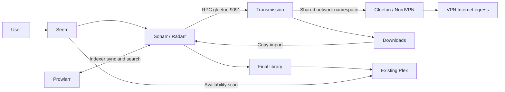

# Bob2 design: Seerr on native TerraMaster TOS

**Updated 6 November 2026 — local bundle; UNVALIDATED on TOS.**
Pilot library folders were created on TNAS; folder permissions and native Plex
library paths were checked. No containers started, images pulled or services
deployed. TOS/Docker/Compose compatibility remains unverified. The user limited
NAS checks to folder permissions and Plex; broader inventory is not authorised.
Historical Proxmox/ZFS descriptions elsewhere are not deployment inputs.

Bob2 is an independent Bobarr replacement repository. The reference preparation
was adapted without its history, infrastructure or application code. Rufus is no
longer the intended coordinator. OpenClaw on TOS remains a separate investigation,
not a dependency. Compute names are hp/hp.lan and dell/dell.lan; no worker access
or changes are part of Bob2. No custom coordinator is needed for media delivery.

## Responsibilities and dependencies

| Service | Owns | Needs / does not own |
|---|---|---|
| Seerr | Discovery, users, request approval and request/availability records | Calls Sonarr for TV and Radarr for films; reads Plex availability. Does not download, rename or play media. SQLite persisted in `/app/config`; PostgreSQL optional. No Redis required by the documented installation. |
| Sonarr | TV monitoring, quality choices, release selection, download queue tracking and TV import/rename/history | Indexer API (Prowlarr here), Transmission RPC and writable download/library paths. Can operate without Seerr. |
| Radarr | Equivalent film lifecycle and film import/history | Same integrations as Sonarr; separate configuration/database. |
| Prowlarr | Indexer definitions, credentials, searches and indexer synchronisation to Sonarr/Radarr | Calls their APIs and indexer sites. No media mounts. Not the automatic import manager or a mandatory upstream for Seerr. |
| Transmission | BitTorrent transfer, resume state and seeding | Receives jobs from Sonarr/Radarr; reports completed paths. Shares Gluetun networking, not library ownership. No Usenet downloader supplied. |
| Gluetun | NordVPN tunnel, DNS and network firewall for Transmission | TOS TUN device, NET_ADMIN and compatible firewall/kernel. No media mounts; no host gateway replacement. |
| Existing Plex | Library catalogue, streaming and playback | Reads final library; remains outside download VPN. Existing deployment preserved. |

Requests belong to Seerr; monitored titles, quality decisions and imports belong
to Sonarr/Radarr; transfer/seeding state belongs to Transmission. Avoid a second
custom orchestration database. Request one title once, let the relevant manager
resolve existing files/quality, and verify duplicate requests in acceptance.

## Compose and configuration contract

[Compose](../compose.yaml) contains six services. [.env.example](../.env.example)
contains blank required inputs; it intentionally cannot run unchanged. Image
repositories are documented there. The wizard defaults to `latest` for a simple
first setup; specific tags/digests can be entered instead. No Plex,
reverse proxy, Redis, worker or OpenClaw containers are added.

Use a specific trusted NAS address for published Seerr/administration ports, with
application authentication and TOS/network access controls. A bound address does
not itself restrict source clients. Do not publish administration or RPC to the
Internet. External `emmjam.linkpc.net` access remains a later decision requiring
HTTPS, authenticated access and proxy testing; no router/DNS/proxy changes now.

After later authorised first start, configure in the application UIs (their keys
are generated at runtime; no invented config files):

| Integration | Setting |
|---|---|
| Seerr → managers | `http://sonarr:8989`, `http://radarr:7878`; private API keys, default server, chosen quality profiles and roots below |
| Prowlarr → managers | Same manager URLs; reciprocal Prowlarr URL `http://prowlarr:9696`; configure/synchronise only selected indexers/categories |
| Managers → downloader | Host `gluetun`, port `9091`, Transmission username/password; distinct `tv` and `movies` categories; test actual category/subdirectory behaviour |
| Transmission | Completed base `/data/downloads/complete`, incomplete `/data/downloads/incomplete`; enable incomplete directory, disable UPnP/NAT-PMP port mapping; configure seeding policy |
| Sonarr root | `/data/media/tv`; enable completed-download handling and hardlinks where supported |
| Radarr root | `/data/media/movies`; equivalent import settings |
| Plex / Seerr | Actual Plex URL, private token and selected library IDs discovered later; test sync and availability after scan |

Pilot destinations agreed on 6 November 2026: new films go to
`/Volume1/SHARED/Movies/bobFilms` and new TV to
`/Volume1/SHARED/Movies/bobTV`. These directories were created and verified on
TNAS. Keep existing media in place until the user is satisfied with Bob2.
Compose maps TV_ROOT to `/data/media/tv` in Sonarr and FILMS_ROOT to
`/data/media/movies` in Radarr. Neither manager can access the existing media
parent or the other pilot library. Do not import existing libraries during the pilot.

DOWNLOAD_ROOT is mapped identically to `/data/downloads` in Transmission,
Sonarr and Radarr. Prowlarr/Seerr need no media filesystem access. Plex reads
only final media using its existing native installation. The two new libraries
were not configured in Plex when last checked; CLI instructions were supplied,
but their execution is unconfirmed. Do not point Plex at incomplete downloads.
Use native Plex scanning or a tested manager Plex connection after successful
import; Seerr's scan reflects availability and does not replace Plex scanning.

The pilot uses separate bind mounts to restrict manager access. Hardlinks/atomic
moves across these container mount boundaries must not be assumed, even if the
NAS directories share a filesystem. Plan for copy imports and extra disk space;
retain downloads for seeding. A common mount for hardlink optimisation is a later
layout decision and must not expose existing libraries without agreement.

Keep CONFIG_ROOT outside DOWNLOAD_ROOT, FILMS_ROOT and TV_ROOT and use local
persistent storage for app SQLite databases, not SMB/NFS. Pre-create only approved
directories during deployment preparation; long bind syntax refuses missing sources.
LSIO services use verified MEDIA_UID/MEDIA_GID and umask 002. Use a dedicated media
group, setgid directories and TOS ACLs consistent with Plex read access. Config
folders remain service-private. Seerr uses explicit SEERR_UID/SEERR_GID (its image
normally runs as node UID 1000); test override and ownership. No recursive chmod,
chown or 0777 fixes on existing media. Compose does not create TOS users or ACLs.

## VPN and failure boundary

Draft selects NordVPN **OpenVPN** with service credentials, not the Nord account
password. This is an implementation choice for review, not a discovered NAS
setting. Country/server eligibility and protocol must be confirmed. WireGuard
would require a separately reviewed template using its real private key; do not
mix OpenVPN credentials with NordLynx assumptions.

Transmission has `network_mode: service:gluetun`, no separate network, no host
ports and no NET_ADMIN. Managers contact Gluetun's internal RPC port; firewall
input allows 9091, protected by RPC authentication. No torrent peer port is
published on the NAS. No broad FIREWALL_OUTBOUND_SUBNETS exception or host-network
mode is provided. Such exceptions can bypass VPN protection and require review.
Transmission mounts an explicit read-only resolver file at `/etc/resolv.conf`,
containing only `nameserver 127.0.0.1`; copy the supplied example to a private,
absolute file path and set TRANSMISSION_RESOLV_FILE. Docker's `dns` option is
unsupported with container network sharing, so it is deliberately absent.
Verify the selected image honours this file and uses Gluetun's loopback resolver.
The draft disables IPv6 in the shared namespace and bridge and disables upstream
IPv6 DNS answers; these are defensive settings, not evidence of no leakage.
If TOS rejects the sysctls, stop and review rather than removing them silently.
Seerr/managers/indexer traffic use ordinary networking in this baseline; only
Transmission downloads/peer/tracker traffic is VPN-isolated. If indexer traffic
also requires VPN, design/test that separately before use.

Gluetun's firewall is the intended kill switch, including tunnel loss; health
status alone is not a kill switch. Initial Transmission creation waits for
Gluetun healthy. Docker daemon restarts and later unhealthy transitions do not
reapply Compose startup gating or automatically stop dependants. Verify firewall
persistence during VPN loss, bad credentials, Gluetun stop/crash/recreation,
Transmission restart and NAS reboot, including IPv4, IPv6 and DNS. On failure,
leave downloads stopped; never fall back to ordinary networking. Recreate/restart
Transmission with Gluetun when the shared namespace changes and recheck egress.

No inbound VPN port forwarding or NAS peer-port publishing is configured.
Confirm the selected NordVPN service's capabilities before changing this.
The VPN does not alter the NAS default route or Plex connectivity.

Private `.env` files are ignored by Bob2 rules. Protect them with
restrictive local permissions; do not paste rendered Compose/environment values
into logs or Git. Environment credentials remain visible to Docker administrators.
Review file-backed secrets supported by the selected images/TOS before production;
local Compose secrets are files, not an encrypted secret store. App configs/backups
also contain API keys and tokens and need equivalent protection.

## Startup, health and maintenance

Only Transmission has a hard startup dependency on Gluetun. Other apps can show
unavailable integrations while services recover; initialise Prowlarr/managers,
then connect Seerr. Gluetun uses its image-provided healthcheck (verify selected
release). Draft probes use Seerr's documented public endpoint, manager/Prowlarr
`/ping`, and Transmission RPC's expected 401 or session-challenge 409. Confirm curl,
wget, endpoints and auth behaviour in the selected images. These are liveness
checks, not proof that a download, import or VPN isolation works. Unhealthy does
not cause Docker to restart a still-running container. Logs rotate by size;
restart policy recovers process exits. Add alerting only after acceptance.

Updates are deliberate: review release notes, pause submissions/downloads, take
consistent backups, record old digests, change one service at a time and rerun
relevant acceptance. No unattended updater or in-container package upgrade.
For Gluetun updates, stop Transmission first and re-establish its shared network
before resuming. Database migrations may prevent image-only rollback; restore a
matching pre-upgrade configuration/database backup with the old image.

Back up every config directory (Seerr DB/settings, manager DBs/configs, Prowlarr
indexer config, Transmission settings/torrents/resume, Gluetun state), private
secrets separately, Compose/env values and image digest inventory. Quiesce apps or
use supported application database backups; do not copy live SQLite DB files
without a consistency method. Choose encrypted backup destination/retention and
test restore into isolated configuration before relying on it. RAID/TRAID and
snapshots alone are not backups. Existing Plex database/settings backups must be confirmed separately; no Plex migration here.

## Implementation and acceptance

Follow [the staged acceptance plan](acceptance.md). Preparation is local only;
all inventory, NAS access and runtime stages require later explicit authorisation.

## Verification sources (official upstream; reviewed 4 November 2026)

- [Seerr Docker image, persistence, user and health](https://docs.seerr.dev/getting-started/docker/),
  [SQLite default / optional PostgreSQL](https://docs.seerr.dev/extending-seerr/database-config/),
  [manager integration](https://docs.seerr.dev/using-seerr/settings/services/).
- [Sonarr](https://github.com/Sonarr/Sonarr), [Radarr](https://github.com/Radarr/Radarr),
  [Prowlarr](https://github.com/Prowlarr/Prowlarr); image configuration:
  [Sonarr](https://docs.linuxserver.io/images/docker-sonarr/),
  [Radarr](https://docs.linuxserver.io/images/docker-radarr/),
  [Prowlarr](https://docs.linuxserver.io/images/docker-prowlarr/),
  [Transmission](https://docs.linuxserver.io/images/docker-transmission/).
- [Gluetun NordVPN credentials/protocols](https://github.com/qdm12/gluetun-wiki/blob/main/setup/providers/nordvpn.md),
  [kill-switch firewall](https://github.com/qdm12/gluetun-wiki/blob/main/faq/firewall.md),
  [firewall exceptions](https://github.com/qdm12/gluetun-wiki/blob/main/setup/options/firewall.md).
- [Compose readiness and restart semantics](https://docs.docker.com/compose/how-tos/startup-order/).
- [Docker shared-container networking restrictions](https://docs.docker.com/engine/network/#container-networks),
  [Gluetun shared network](https://github.com/qdm12/gluetun-wiki/blob/main/setup/connect-a-container-to-gluetun.md),
  [Gluetun DNS settings](https://github.com/qdm12/gluetun-wiki/blob/main/setup/options/dns.md).

Sources establish upstream capabilities, not compatibility with the unknown TOS
installation. See [continuation](../TASK-CONTINUATION-BOB2.md) for resume state.
